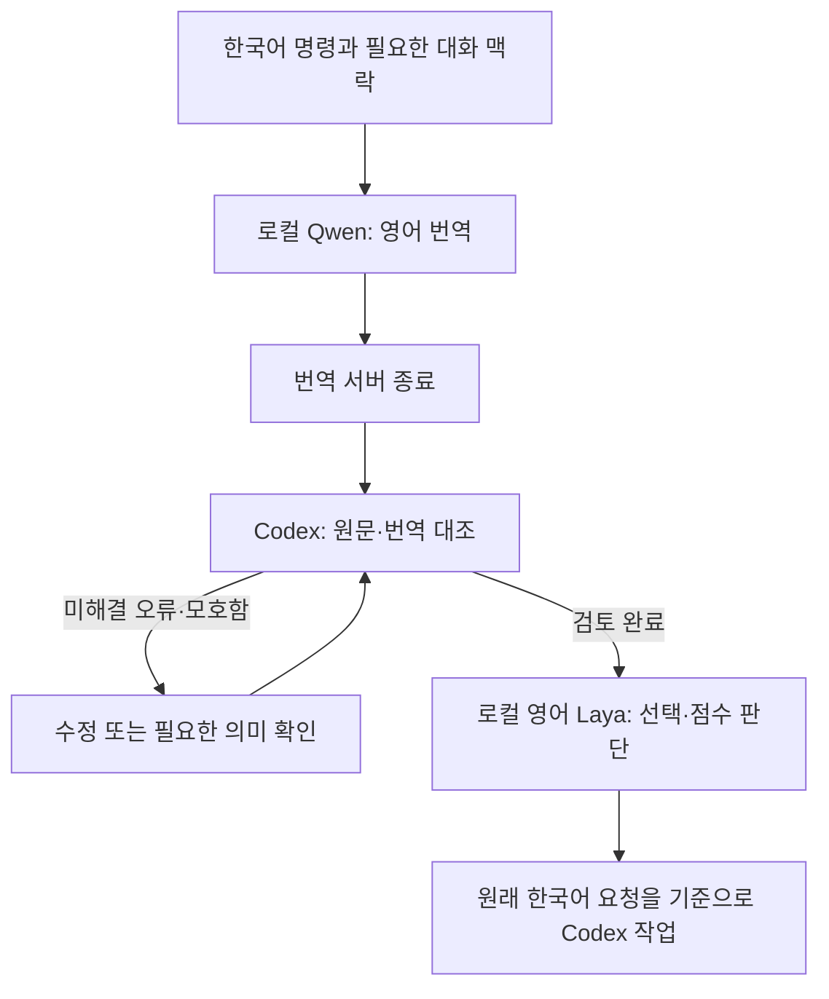

# 한국어 명령을 로컬 번역하고 판단하는 Codex Skill

**한국어 지시 → Qwen 영어 번역 → Codex 의미 검토 → Laya 판단 → 원래 요청 수행**을 하나의 `$laya-command` 호출로 연결합니다.

`laya-command`와 필요한 `ko-en-command`를 함께 제공하는 Windows용 스킬 묶음입니다. 번역·판단 모델은 PC에서 실행하고, Codex는 번역을 대조하고 실제 도구 작업을 이어갑니다. 두 로컬 모델을 순서대로 실행해 메모리가 겹치는 시간을 줄입니다.

> **현재 상태: 개인 시험용 구현.** 연결 실행과 제한된 예제 검사는 확인했지만, 범용 명령 분류의 정확도 향상이나 실무 안전성을 입증한 제품은 아닙니다. 실제 오분류도 아래에 공개합니다. Laya 결과가 원래 명령을 대체하거나 삭제·게시 같은 행동을 승인하지 않습니다.

## 사용 모습

Codex에서:

```text
$laya-command 현재 폴더의 파일 목록만 보여줘. 삭제하거나 수정하지 마.
```

또는 실제 분류 작업:

```text
$laya-command 다음 문의들을 결제·기술지원·구매문의로 분류해줘.
```

첫 번째는 기본 요청 유형 판단, 두 번째는 사용자가 정한 업무 분류 기준을 적용하는 예입니다. Codex가 입력·질문 파일을 준비하므로 사용자가 JSON을 직접 만들 필요는 없습니다. 자동 선택도 허용되어 있으나, 모든 한국어 채팅을 강제로 가로채는 기능은 아닙니다. 확실하게 함께 사용하려면 `$laya-command`를 붙입니다.

## 어떻게 작동하나



| 구성 | 맡는 일 | 맡지 않는 일 |
|---|---|---|
| Qwen3-4B-Instruct-2507 Q4_K_M | 한국어를 영어로 번역; 필요한 앞 대화·용어집 반영 | 명령 실행, 번역 정확성 보장 |
| ko-en-command 검사 | 백틱의 경로·식별자, 숫자, 일부 수량 경계 보존 확인 | 모든 의미 오류 탐지 |
| Codex | 행위자·대상·부정·조건·순서·범위 대조; 원래 요청 수행 | Laya 점수를 사실이나 권한으로 취급 |
| 영어 Laya 421M | 주어진 질문과 선택지에 대한 판단 | 자유로운 글 생성, 임의 PC 명령 실행 |

Qwen은 일반 언어 모델을 번역 지시로 사용하는 구성입니다. 전용 번역 모델보다 우수하다는 비교 실험은 하지 않았습니다. Laya의 다국어 322M 모델을 바로 쓰는 방식과도 성능 비교하지 않았으므로, 번역 단계를 더하면 무조건 좋아진다고 주장하지 않습니다. [Qwen 원본](https://huggingface.co/Qwen/Qwen3-4B-Instruct-2507), [Laya 모델 설명](https://huggingface.co/convaiinnovations/laya)

## 설치

### 준비 사항

- Windows x64, PowerShell, Git, Python 3.11을 기준으로 작성했습니다.
- 측정 PC는 RAM 16GB급입니다. 더 적은 RAM에서의 동작이나 최소 사양은 검증하지 않았습니다. 다른 앱을 닫아 수 GB 이상의 메모리 여유를 확보하는 편이 좋습니다.
- 모델 파일만 약 3.34GB: Qwen GGUF 약 2.50GB + 영어 Laya 가중치 약 0.84GB. Python 환경·DLL·캐시·설치 중 임시 파일까지 고려해 **디스크 여유 8GB 이상을 준비하는 것을 권장**합니다. 이는 실측 최소 설치 용량이 아닙니다.
- 초기 설치에는 GitHub·PyPI·PyTorch·Hugging Face 접속이 필요합니다. 설치 후 번역·판단 모델 추론에는 클라우드 모델 키가 필요하지 않습니다.
- Codex가 수행하는 번역 검토·후속 작업은 Codex 호스트의 실행·네트워크·사용량 정책을 따릅니다. 전체 작업을 완전한 오프라인 시스템이라고 주장하지 않습니다.

### 1. 저장소 받기

```powershell
git clone https://github.com/Kimhyuntae9665/laya-command.git
Set-Location laya-command
```

### 2. 실행 환경과 모델 설치

```powershell
& './scripts/setup-runtime.ps1'
```

기본 위치는 `%LOCALAPPDATA%/LayaCommand`입니다. Python 3.11이 `python` 명령으로 실행되는지 먼저 확인하세요. 다른 Python 경로는 `-Python 'C:/path/to/python.exe'`로 지정합니다.

기본 위치를 바꾸려면:

```powershell
$env:KO_EN_RUNTIME = 'D:/AI/LayaCommand'
& './scripts/setup-runtime.ps1' -Runtime $env:KO_EN_RUNTIME
```

다른 위치를 쓰는 경우 **Codex 프로세스에서도 같은 `KO_EN_RUNTIME` 값을 볼 수 있어야 합니다.** 현재 PowerShell에서 설정한 값은 이미 열려 있는 Codex에 자동 반영되지 않습니다. 필요하면 해당 환경 변수를 설정한 뒤 Codex를 다시 시작합니다.

이미 호환되는 환경이 있다면 재다운로드 대신 확인만 할 수 있습니다:

```powershell
& './scripts/setup-runtime.ps1' -Runtime 'D:/AI/LayaCommand' -CheckOnly
```

다운로드는 Qwen GGUF와 Laya의 고정 리비전, llama.cpp `b11960` CPU 빌드를 사용합니다. Qwen GGUF는 SHA-256을 검사합니다. 리비전·파일명·해시는 [setup_runtime.py](scripts/setup_runtime.py)에 있습니다. Qwen 파일 해시는 검증하지만 모든 제3자 파일의 독립적인 무결성·보안 감사를 제공하는 설치기는 아닙니다.

### 3. 두 스킬 설치

```powershell
& './scripts/install-skills.ps1'
```

`CODEX_HOME`을 지정했다면 그 아래 `skills`, 없으면 `~/.codex/skills`에 두 스킬을 나란히 설치합니다. 기존 동명 스킬이 있으면 중단합니다. 기존 내용을 보관한 뒤 의도적으로 교체할 때만 `-Force`를 사용하세요.

새 채팅에서 `$laya-command`를 선택합니다. 목록에 바로 나타나지 않으면 Codex를 다시 열어 확인하세요. 스킬 발견 시점은 호스트에 따라 다를 수 있습니다.

## 직접 실행하는 방법

저장소 폴더에서도 스킬 설치 없이 도구를 시험할 수 있습니다. `KO_EN_RUNTIME` 또는 기본 위치에 실행 환경이 있어야 합니다.

### 1. 한국어 입력 번역

```powershell
& './skills/laya-command/scripts/run.ps1' `
  -Text '삭제하지 말고 목록만 보여줘.' `
  -OutputDir './work/example-01'
```

긴 문장·따옴표·경로가 포함된 입력은 UTF-8 파일로 저장하고 `-InputFile './source.txt'`를 쓰는 편이 안전합니다. 원문을 PowerShell 명령 문자열에 직접 끼워 넣지 않습니다. `-Context '관련 앞 대화'`, `-Glossary './glossary.json'`도 지원합니다. 용어집은 `{"작업 대기열":"job queue"}` 형태입니다.

`translation.json`에 아래 정보가 저장됩니다:

- `source_ko`, `context`: 원문과 전달한 맥락
- `english`, `raw_model_english`: 후처리된 번역과 원래 모델 출력
- `constraint_repairs`: 유일하게 대응하는 숫자 경계를 원문에 맞춰 복원한 내역
- `warnings`: 숫자·리터럴·용어집 누락 등 확인이 필요한 항목
- `elapsed_seconds`: 번역 서버 시작·요청·종료를 포함하는 번역 도구 측정 시간

같은 결과 폴더의 번역은 덮어쓰지 않습니다. 새 시도에는 새 `OutputDir`을 사용합니다.

### 2. 원문과 번역 대조

Codex 또는 사용자가 원문과 비교합니다. 특히 “하지 마”, “승인한 뒤”, “이상/초과”, 파일명과 경로를 확인합니다. 경고가 없다고 의미가 같은 것은 아닙니다.

번역 오류를 수정할 때는 원래 JSON을 보관하고 수정 내용과 근거를 기록합니다. 미해결 경고를 지우고 통과시키지 않습니다. `-Reviewed`는 실제 검토를 했다는 표시이며, 프로그램이 의미 검토를 자동 증명하거나 검토자의 신원을 인증하는 장치는 아닙니다.

### 3. Laya 실행

```powershell
& './skills/laya-command/scripts/run.ps1' `
  -OutputDir './work/example-01' -Reviewed
```

번역에 경고가 있거나 Laya 입력이 잘리면 실패합니다. 성공하면 `result.json`에 원문·번역·질문·모델 결과와 `timing`이 저장됩니다. 질문을 바꾸지 않으면 `information / change / mixed / unclear` 중 하나를 판단합니다. 이 기본 질문은 범용 명령 분류기로 별도 학습한 모델이 아닙니다.

### 사용자 정의 분류 질문

실제 업무에는 요청 유형보다 대상 업무의 분류 기준을 직접 지정하는 편이 목적에 맞습니다. 다음 파일을 `questions.json`으로 저장합니다:

```json
{
  "department": {
    "type": "choice",
    "instructions": "Which department should handle this request?",
    "criteria": {
      "billing": "Payments, invoices and refunds",
      "technical": "Software errors, crashes and outages",
      "sales": "Pricing and new purchases"
    }
  }
}
```

환불 문의를 번역·검토한 결과 폴더에 적용:

```powershell
& './skills/laya-command/scripts/run.ps1' `
  -OutputDir './work/refund-01' -Reviewed -Questions './questions.json'
```

영어 질문·선택지 설명을 사용하고 키·ID는 유지합니다. `choice`, `score`, `noul` 등 실제 지원 형식과 의미는 [Laya 문서](https://nandhakishorm.github.io/laya/)를 참고하세요.

## 성능과 검증 범위

측정일: **2026-11-02**. Intel Core Ultra 5 225H / RAM 약 15.53GiB / Windows / CPU 6스레드, GPU는 사용하지 않았습니다. Qwen Q4_K_M + llama.cpp b11960, 영어 Laya + PyTorch CPU 환경입니다.

| 측정 항목 | 이번 PC의 결과 | 해석 |
|---|---:|---|
| 한국어 → 영어 번역 4건 | 7.52~17.77초, 중앙값 9.76초 | 요청별 서버 시작·종료 포함 |
| Laya 라이브러리 import | 9.53초 | 한 프로세스에서 1회 관측 |
| 영어 Laya 모델 로딩 | 14.69초 | import 이후 로딩 시간; 한 번 관측 |
| 로딩 후 판단 12회 | 0.82~1.14초, 중앙값 0.879초 | 4개 입력 × 3회; 같은 프로세스 |
| 기본 요청 유형의 예상값 일치 | **2/4건** | 작은 예제에서의 일치 수; 일반 정확도 아님 |

| 입력 요약 | 작성자가 정한 예상값 | Laya 결과 | 일치 |
|---|---|---|---|
| 파일 목록만 표시, 삭제·수정 금지 | information | information | O |
| 새 README 파일 만들기 | change | information | X |
| GitHub 게시 + README 작성 | change | information | X |
| 맥락 없는 “그거 해줘” | unclear | unclear | O |

**새 README 만들기처럼 명확한 변경 요청도 잘못 분류했습니다.** 기본 질문만으로 범용 명령 분류를 신뢰하기 어렵다는 실제 관측입니다. 출력을 실행 권한 판정에 사용하지 않고 원문을 기준으로 진행합니다.

이 값은 영어 421M 모델에 요청 유형 질문을 넣어 측정한 것입니다. 다국어 322M 모델의 짧은 문의 분류 시간이나 upstream의 GPU 벤치마크와 같은 조건이 아닙니다. `수십 ms` 같은 upstream 수치를 이 번역·검토·판단 전체 과정의 성능으로 소개하지 않습니다.

측정 방법:

1. [고정 예제 4개](benchmarks/cases.json)를 각기 새 번역 서버로 번역합니다.
2. Codex가 한국어와 번역을 대조한 후, Laya를 한 번 불러옵니다.
3. 각 번역을 같은 Laya 프로세스에서 3회 판단합니다. 첫 판단도 포함합니다.
4. 원시 시간·번역·출력·예상 분류·일치 여부·경고를 [results.json](benchmarks/results.json)에 보존합니다.

이 네 예제는 작성자가 고른 합성 입력입니다. 독립 평가자·별도 평가 데이터가 없고, 성공률의 일반화·정답 확률 보정·보안 판정력을 검증하지 않았습니다. 피크 RAM, 전력, 사용자 검토 시간을 포함한 전체 소요 시간도 측정하지 않았습니다. 모델 서버를 매 요청 다시 시작하는 번역 비용은 빠른 Laya 판단 시간보다 훨씬 큽니다.

**이 저장소의 목표는 두 모델의 재현 가능한 연결과 원문 보존입니다.** Codex 단독, 번역 없이 다국어 Laya, 다른 번역 모델보다 더 정확하거나 빠르다는 결론은 이 결과에서 낼 수 없습니다. 위에서 공개한 오분류 때문에 기본 요청 유형 결과를 자동 행동의 허용/거부 기준으로 사용하지 않습니다.

### 재측정

```powershell
$runtime = Join-Path $env:LOCALAPPDATA 'LayaCommand'
$python = Join-Path $runtime '.venv/Scripts/python.exe'
& $python './scripts/benchmark.py' translate --runtime $runtime --output './work/bench-01'
# work/bench-01/translations.json의 모든 번역을 원문과 비교한 뒤:
& $python './scripts/benchmark.py' decide --reviewed --runtime $runtime --output './work/bench-01'
```

벤치마크 보고서의 하드웨어 표기는 최초 측정 PC 값으로 작성되어 있습니다. 다른 PC에서 실행할 때는 `scripts/benchmark.py`의 `hardware` 메타데이터를 실제 사양으로 바꿔 기록하세요. 다른 PC의 결과를 최초 PC의 결과처럼 표시하지 않습니다.

## 한계와 문제 해결

| 상황 | 동작 / 대응 |
|---|---|
| 번역의 `warnings`가 남음 | Laya 전달을 차단합니다. 원문·번역을 대조하고 원인을 해결합니다. |
| 경고 없이 의미가 바뀜 | 자동 검사가 놓칠 수 있습니다. Codex 대조가 필요한 이유입니다. |
| 명령의 대상이 불분명함 | 필요한 대화 맥락을 `Context`로 전달합니다. 없는 맥락을 만들지 않습니다. |
| Laya가 잘못 분류함 | 원래 한국어 요청을 우선합니다. 업무별 평가·조정이 필요합니다. |
| Laya 온도 보정 경고 | 일부 체크포인트 값에 대해 런타임이 보정 범위를 적용할 수 있습니다. 점수를 실제 정답률로 읽지 않습니다. |
| 입력이 길거나 잘림 | 번역기는 문자 수 제한과 생성 완료를 확인하고 Laya는 잘린 입력을 거부합니다. 조건을 몰래 제거하지 않습니다. |
| 메모리가 부족함 | 다른 앱을 닫고 순차 실행합니다. WireGuard/원격 PC는 이 저장소의 필수 구성 요소가 아닙니다. |
| Python 경로를 못 찾음 | 기본 위치 또는 `KO_EN_RUNTIME`과 `.venv/Scripts/python.exe`를 확인합니다. |
| PowerShell 실행이 조직 정책으로 차단됨 | 조직 정책을 따릅니다. 자동으로 실행 정책을 변경하지 않습니다. |

로컬 번역 서버는 `127.0.0.1`의 임시 포트와 요청별 인증 키를 쓰고 종료합니다. 입력 문장은 자동으로 셸 명령으로 실행되지 않습니다. 그러나 `translation.json`과 `result.json`에는 원문이 저장되므로 민감한 입력을 공유할 때는 결과 파일도 확인해야 합니다.

## 저장소 구성과 검사

```text
skills/laya-command/       통합 스킬, 순차 실행 도구, 기본 질문
skills/ko-en-command/      번역·검사·Laya 전달 도구
scripts/                  설치, 환경 확인, 소규모 벤치마크
benchmarks/               예제와 실제 측정 결과
tests/                    모델 없이 실행하는 입력 보호 검사
```

```powershell
python -m unittest discover -s tests -v
```

CI는 가벼운 보호 검사와 PowerShell 문법 검사만 합니다. 수 GB 모델을 내려받아 추론 품질을 검사하는 CI가 아닙니다. 공개 전에는 기존 로컬 환경의 모델을 재사용해 추론과 경로 변경을 확인했습니다. **완전히 빈 PC에서 전체 모델을 다시 내려받는 설치 과정은 재실행하지 않았습니다.**

## 라이선스와 제작 범위

스킬·도구 코드는 [MIT](LICENSE), 외부 모델·실행 파일은 각각의 라이선스를 따릅니다. 가중치·DLL·개인 PC 경로·인증 정보는 저장소에 포함하지 않습니다. [구성 요소와 출처](NOTICE.md)

사용자의 요구와 검토를 바탕으로 Codex가 구현·검사·문서 작성을 지원한 개인 프로젝트입니다. 모델 자체를 학습한 실적이나 실제 회사에 도입한 운영 성과로 제시하지 않습니다.
